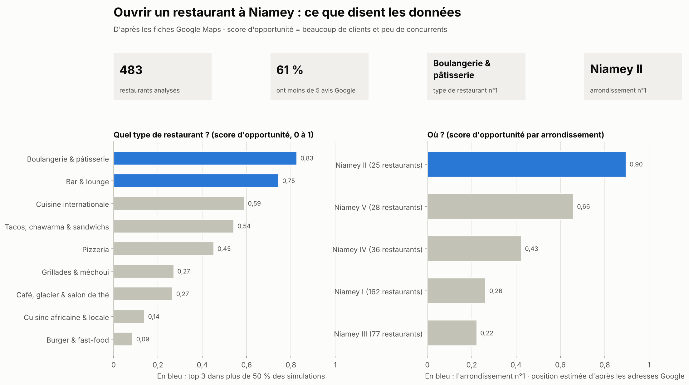
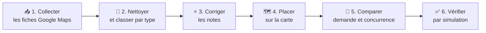
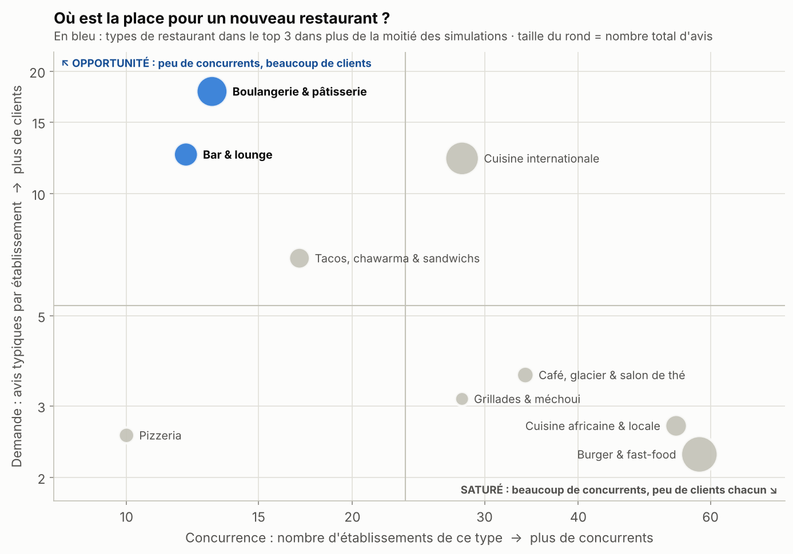
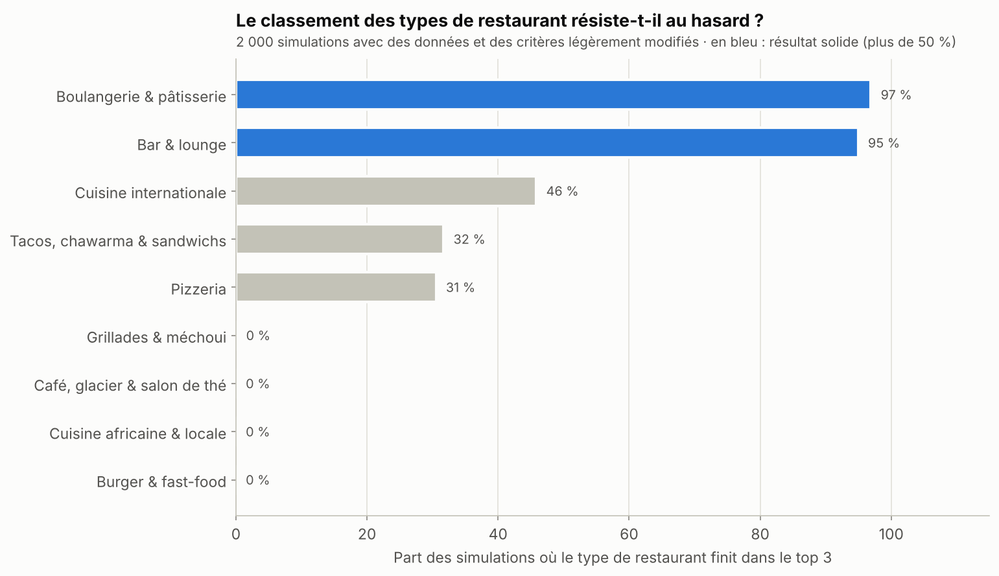
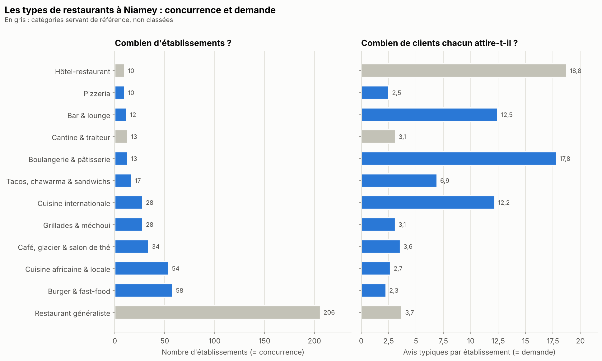
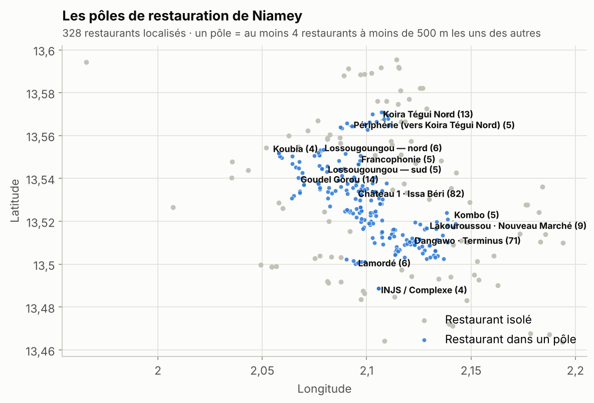

# 🍽️ Quel restaurant ouvrir à Niamey, et où ?

Ce projet part d'une question simple que se pose tout futur restaurateur :
**« Quel type de restaurant ouvrir à Niamey, et à quel endroit, pour avoir le plus de chances de réussir ? »**

Pour y répondre, on a analysé **les fiches Google Maps de près de 500 établissements** de la ville :
leur type, leur note, leur nombre d'avis et leur position sur la carte.

👉 **[Ouvrir la carte interactive](https://blakro.github.io/Niamey_restaurants_analysis/map_PORTFOLIO.html)** : tous les restaurants, filtrables par type, avec leur fiche
👉 **[Lire les résultats détaillés](RESULTATS.md)** : tous les chiffres et tableaux



---

## 🔑 Ce que disent les données

<!-- RESULTATS:DEBUT -->

*Chiffres calculés automatiquement le 05/11/2026.*

1. **483 restaurants analysés** (sur 490 fiches Google Maps, après suppression des doublons et des commerces qui ne sont pas des restaurants).
2. **61 % des restaurants ont moins de 5 avis** : la réputation en ligne reste très peu développée à Niamey. Seuls 127 restaurants (26 %) ont une note vraiment solide (au moins 10 avis).
3. **85 des 86 restaurants notés 5★ ont 5 avis ou moins.** C'est pourquoi on utilise une *note corrigée*, qui ne se laisse pas impressionner par 1 ou 2 avis.
4. **Aucun type de cuisine n'est mieux noté qu'un autre** de façon fiable (p = 0,35). Ce qui distingue les concepts, c'est la **demande** (clients par établissement) et la **concurrence**.
5. **Concepts les plus prometteurs** : **Boulangerie & pâtisserie** (13 établissements, 17,8 avis typiques chacun, top 3 dans 97 % des simulations) ; **Bar & lounge** (12 établissements, 12,5 avis typiques chacun, top 3 dans 95 % des simulations). À comparer avec 3,7 avis pour un restaurant généraliste.
6. **Concepts saturés : Burger & fast-food** et **Cuisine africaine & locale** — 58 établissements, seulement 2,3 avis chacun ; 54 établissements, seulement 2,7 avis chacun.
7. **Où ?** 47 % des restaurants localisés sont concentrés dans 2 pôles. Dans le pôle **Château 1 · Issa Béri**, chaque restaurant attire 6,7 avis typiques, contre 2,6 dans le pôle **Dangawo · Terminus**, presque aussi fourni mais nettement plus saturé. Par arrondissement, **Niamey II** arrive en tête (n°1 dans 79 % des simulations).
8. **Un site web va de pair avec 8× plus d'avis** (médiane 15,5 contre 2,0, p < 0,001), **mais pas avec une meilleure note** (p = 0,11) : c'est un levier de visibilité, pas de qualité.

**Pistes concrètes (type × lieu)** — un concept prometteur là où il est absent :

- **Boulangerie & pâtisserie** dans le pôle **Château 1 · Issa Béri** : aucun établissement de ce type parmi 82 restaurants (4 460 avis au total).
- **Bar & lounge** dans le pôle **Château 1 · Issa Béri** : 1 seul établissement de ce type parmi 82 restaurants (4 460 avis au total).
- **Bar & lounge** dans le pôle **Dangawo · Terminus** : aucun établissement de ce type parmi 71 restaurants (2 244 avis au total).

> ⚠️ Les données viennent d'une recherche « restaurants » sur Google Maps : les boulangeries, bars ou cafés qui ne se présentent pas aussi comme restaurants n'y figurent pas. Avant d'investir, il faut **compter la concurrence réelle sur le terrain** — ces résultats indiquent des pistes, pas des certitudes.

<!-- RESULTATS:FIN -->

---

## 🧭 Comment on a procédé, en 6 étapes



### 1. Collecter 📥

On part d'un export de Google Maps : pour chaque établissement, son **nom**, son **type** selon Google,
sa **note** (sur 5), son **nombre d'avis**, son **adresse**, son téléphone et son site web.
C'est la source publique la plus complète sur les restaurants de Niamey.

### 2. Nettoyer et classer 🧹

Les données brutes contiennent des erreurs. On les corrige avant toute analyse :

- on supprime les **doublons** (le même restaurant enregistré deux fois) ;
- on écarte ce qui n'est **pas un restaurant** (épicerie, parc de loisirs, vendeur de légumes…) ;
- on répare une ligne dont les informations avaient glissé d'une colonne.

Surtout, on **devine le type de chaque restaurant**. Google range 2 établissements sur 3 dans la case
« Restaurant », sans plus de détail, et se trompe parfois (un fast-food de burgers était classé
« cuisine indienne d'Odisha »). On lit donc aussi le **nom** de l'établissement :
« Pizza Club » → *Pizzeria*, « Maquis Doré » → *Cuisine africaine & locale*,
« Boulangerie Rayan » → *Boulangerie & pâtisserie*, « French Tacos » → *Tacos, chawarma & sandwichs*…

### 3. Corriger les notes ⭐

> Un élève qui a eu 20/20 à **un seul** contrôle n'est pas forcément meilleur qu'un élève qui a
> 18 de moyenne sur **toute l'année**.

C'est pareil pour les restaurants : un 5★ obtenu avec un seul avis ne veut pas dire grand-chose.
On calcule donc une **note corrigée** : on fait comme si chaque restaurant avait déjà reçu 10 avis
« moyens » avant ses vrais avis. Résultat :

- 5★ sur **1 avis** → environ **4,2★** (on manque d'informations, on reste prudent) ;
- 4,9★ sur **443 avis** → reste à **4,9★** (beaucoup d'avis, la note est fiable).

### 4. Placer sur la carte 🗺️

Beaucoup d'adresses Google sont des **Plus Codes**, une sorte d'adresse GPS courte (ex. `G476+RX4`).
On les convertit en coordonnées, ce qui permet de placer **2 restaurants sur 3** sur la carte, puis :

- de rattacher chaque restaurant à son **quartier** et à son **arrondissement** (Niamey I à V) ;
- de repérer les **pôles de restauration** : des groupes d'au moins 4 restaurants situés à moins de
  500 mètres les uns des autres (comme une « rue des restaurants »).

### 5. Comparer : le score d'opportunité 🎯

Pour chaque type de restaurant (et pour chaque zone), on se pose **trois questions** :

| Question | Ce qu'on mesure | Importance |
|---|---|---|
| 👥 **Y a-t-il des clients ?** | Le nombre d'avis d'un établissement typique. Plus il y a d'avis, plus il y a de clients. | 45 % |
| 🏪 **Y a-t-il peu de concurrents ?** | Le nombre d'établissements du même type. | 35 % |
| 📈 **Peut-on faire mieux que l'existant ?** | La note moyenne : si les clients sont moyennement satisfaits, un nouveau venu de qualité a sa chance. | 20 % |

Les trois réponses sont combinées en un **score d'opportunité de 0 à 1**.
L'idée est simple : **beaucoup de clients + peu de concurrents = une place à prendre.**

### 6. Vérifier par simulation ✅

Certains groupes ne comptent qu'une dizaine d'établissements : le classement pourrait être dû au hasard.
On **rejoue donc le calcul 2 000 fois**, en changeant à chaque fois un peu les données et l'importance
des trois questions. Si un type de restaurant reste dans le **top 3 dans plus de la moitié des cas**,
on peut s'y fier.

---

## 📊 Les résultats en images

**Où est la place pour un nouveau restaurant ?** En haut à gauche : beaucoup de clients par établissement
et peu de concurrents. En bas à droite : marché saturé.



**Le classement résiste-t-il au hasard ?**



**Concurrence et demande, type par type**



**Les pôles de restauration**



---

## ⚠️ Ce que ces résultats ne disent pas

- **Un avis n'est pas une vente.** Le nombre d'avis Google donne une idée de la fréquentation, mais
  beaucoup de clients n'en laissent jamais, surtout dans les lieux populaires.
- **Tout le monde n'est pas sur Google Maps.** Les données viennent d'une recherche « restaurants » :
  les boulangeries, bars ou cafés qui ne se présentent pas aussi comme restaurants n'y sont pas, et une
  partie des restaurants de la ville n'a pas de fiche du tout.
- **Les quartiers sont approximatifs.** On utilise le centre de chaque quartier, pas ses limites officielles.
- **C'est une photo à un instant donné**, sans historique des ouvertures et fermetures.

**En pratique :** ces résultats indiquent des **pistes à vérifier sur le terrain** (compter les
concurrents, observer la fréquentation, parler aux habitants), pas des certitudes.

---

## 📖 Petit glossaire

| Mot | Signification |
|---|---|
| **Note corrigée** | Note Google ajustée selon le nombre d'avis (voir étape 3). |
| **Avis typiques** | Nombre d'avis d'un établissement « ordinaire » d'un groupe. On n'utilise pas la moyenne classique, qui serait faussée par un ou deux restaurants très célèbres. |
| **Pôle de restauration** | Groupe d'au moins 4 restaurants à moins de 500 m les uns des autres. |
| **Plus Code** | Adresse GPS courte inventée par Google (ex. `G476+RX4`). |
| **Score d'opportunité** | Note de 0 à 1 combinant clients, concurrence et marge de progression. |
| **p (p-value)** | Probabilité qu'une différence observée soit due au hasard. En dessous de 0,05, on considère qu'elle est réelle. |
| **Confiance** | *Bonne* si le groupe compte au moins 8 établissements avec 10 avis ou plus ; *Faible* en dessous de 4. |

---

## 🛠️ Pour les curieux : refaire l'analyse

<details>
<summary><b>Installation et lancement</b> (Python 3.11 ou plus récent)</summary>

```bash
git clone https://github.com/blakro/Niamey_restaurants_analysis
cd Niamey_restaurants_analysis
python -m venv .venv && source .venv/bin/activate   # Windows : .venv\Scripts\activate
pip install -r requirements.txt
```

Relancer **toute** l'analyse en une commande (environ 15 secondes). Elle régénère les tableaux, les
graphiques, la carte, [`RESULTATS.md`](RESULTATS.md) et le bloc « Ce que disent les données » de ce README :

```bash
python run_pipeline.py
```

Vérifier que tout fonctionne (tests automatiques) :

```bash
python -m pytest
```

Explorer pas à pas dans les notebooks :

```bash
jupyter lab
```

</details>

<details>
<summary><b>Organisation du dépôt</b></summary>

```
Niamey_restaurants_analysis/
├── README.md                  ← ce document
├── RESULTATS.md               ← tous les chiffres (généré automatiquement)
├── run_pipeline.py            ← relance toute l'analyse
├── niamey/                    ← le code de l'analyse, une étape par fichier
│   ├── config.py              ←   tous les réglages (seuils, poids, rayons) au même endroit
│   ├── cleaning.py            ←   étape 2-3 : nettoyage, note corrigée
│   ├── concepts.py            ←   étape 2 : type de restaurant d'après le nom
│   ├── geo.py                 ←   étape 4 : Plus Codes, quartiers, pôles (DBSCAN)
│   ├── stats.py               ←   tests statistiques
│   ├── opportunity.py         ←   étapes 5-6 : score d'opportunité, simulations
│   ├── viz.py · maps.py       ←   graphiques et carte interactive
│   ├── report.py              ←   RESULTATS.md et bloc du README
│   └── pipeline.py            ←   enchaîne le tout
├── notebooks/                 ← la même analyse, expliquée pas à pas
│   ├── 01_cleaning.ipynb      ←   nettoyage, types, note corrigée
│   ├── 02_eda.ipynb           ←   exploration, SQL (DuckDB), tests statistiques
│   ├── 03_geospatial.ipynb    ←   carte, quartiers, pôles
│   └── 04_market_gaps.ipynb   ←   score d'opportunité, simulations, recommandations
├── tests/                     ← tests automatiques
├── data/
│   ├── raw/                   ← données sources (export Google Maps, repères de quartiers)
│   └── processed/             ← fichiers produits par l'analyse (non versionnés)
└── docs/                      ← publié sur GitHub Pages : carte interactive + images du README
```

</details>

<details>
<summary><b>Méthodes utilisées (vocabulaire technique)</b></summary>

| Étape | Méthode |
|---|---|
| Note corrigée | Moyenne bayésienne, a priori de 10 avis à la note moyenne du marché (sensibilité vérifiée dans le notebook 01) |
| Type de restaurant | Règles de mots-clés sur le nom normalisé, repli sur la catégorie Google |
| Tests | Kruskal-Wallis (notes par type), Mann-Whitney U (effet du site web), corrélation de Spearman |
| Demande | Moyenne géométrique de (1 + nombre d'avis), robuste aux valeurs extrêmes |
| Géographie | Décodage des Open Location Codes, distances de haversine, plus proche voisin (BallTree), DBSCAN |
| Décision | Score multicritère pondéré (45/35/20) |
| Robustesse | 2 000 simulations : bootstrap des établissements + poids tirés selon une loi de Dirichlet |

Stack : `Python` · `pandas` · `NumPy` · `SciPy` · `scikit-learn` · `DuckDB` · `Matplotlib` · `Folium` · `pytest`

</details>

<details>
<summary><b>Ce qui a changé par rapport à la première version</b></summary>

- **Conclusions corrigées.** Certaines conclusions étaient écrites à la main et contredisaient les calculs :
  la première version affirmait que les notes différaient selon le type de cuisine (le test dit le contraire,
  p = 0,35) et qu'un site web allait de pair avec une meilleure note (non significatif). Tous les chiffres
  sont désormais **calculés**, puis recopiés automatiquement dans le README et `RESULTATS.md`.
- **Bug corrigé dans l'analyse par zone** : les noms de zones étaient associés aux mauvais groupes de
  restaurants (confusion entre deux numérotations).
- **Types de restaurants mieux identifiés** : on lit le nom en plus de l'étiquette Google (la part de
  « Restaurant » sans précision passe de 68 % à 43 %). Les catégories artificielles « Autre » et
  « Restaurant halal » ne sont plus présentées comme des opportunités.
- **Note corrigée plus juste** : a priori de 10 avis au lieu de la moyenne (≈ 39, tirée vers le haut par
  quelques adresses célèbres), qui écrasait toutes les notes autour de 4,1.
- **Modèle d'opportunité repensé** sur des critères compréhensibles (clients, concurrence, marge de
  progression), avec **2 000 simulations** pour vérifier la solidité du classement.
- **Données nettoyées** : ligne décalée réparée, doublons et commerces hors restauration retirés.
- **Reproductible** : une commande pour tout régénérer, des tests automatiques, un code partagé par les
  notebooks et le script ; le notebook 04 n'écrase plus le README.
- **Carte** : filtre par type de restaurant, fiches détaillées, fonds de carte sans clé d'API.

</details>

---

## 📄 Licence et source

Code sous licence MIT (voir [`LICENSE`](LICENSE)).
Données : fiches publiques Google Maps, Niamey (Niger). Carte : © contributeurs OpenStreetMap.
