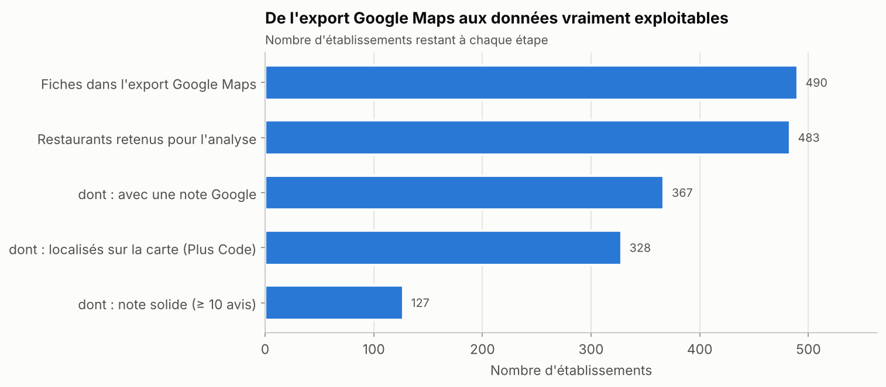
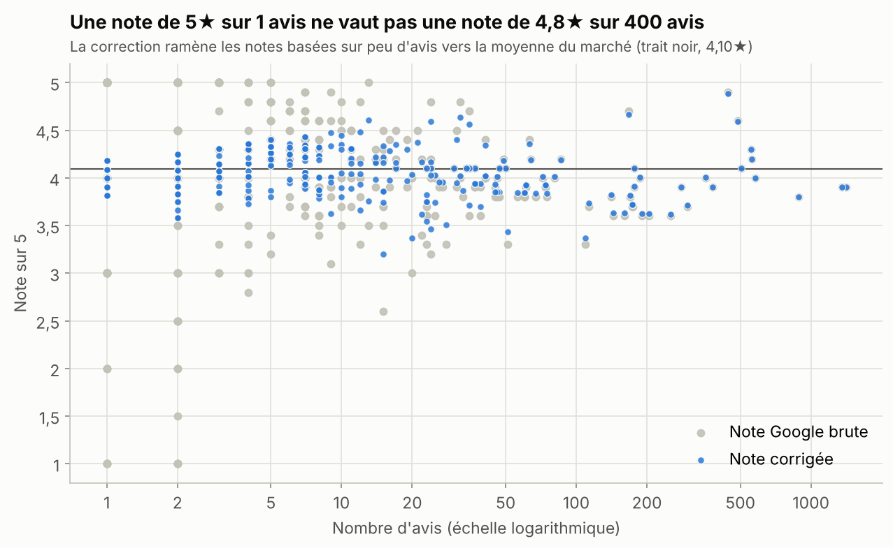
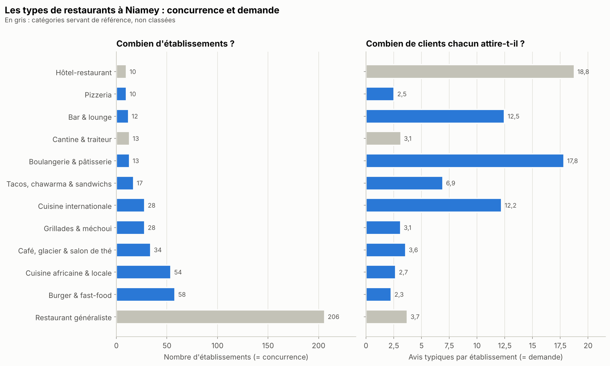
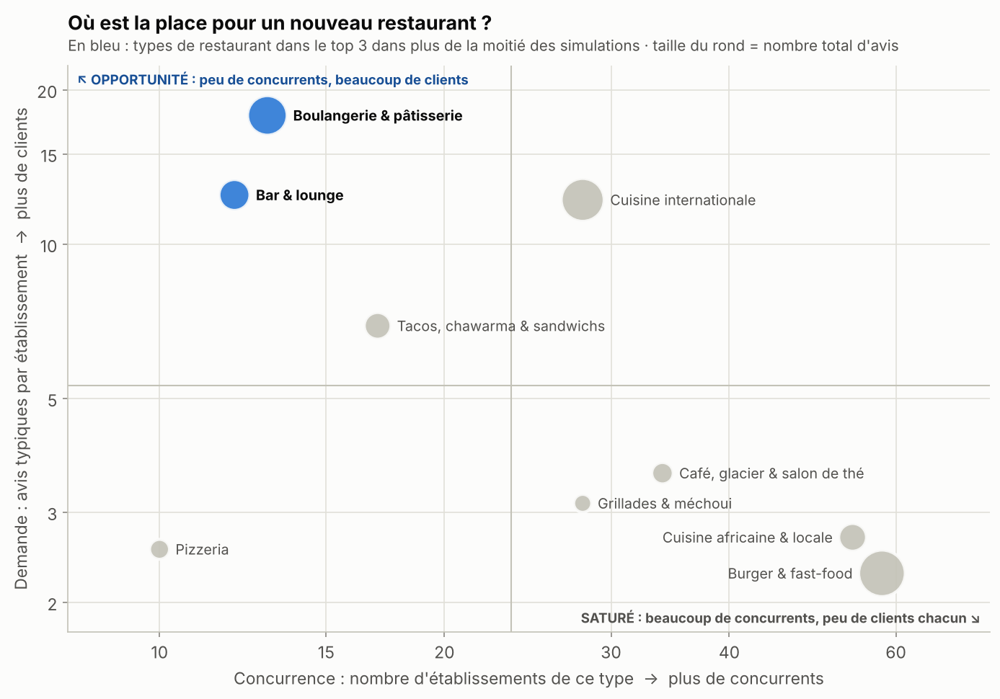
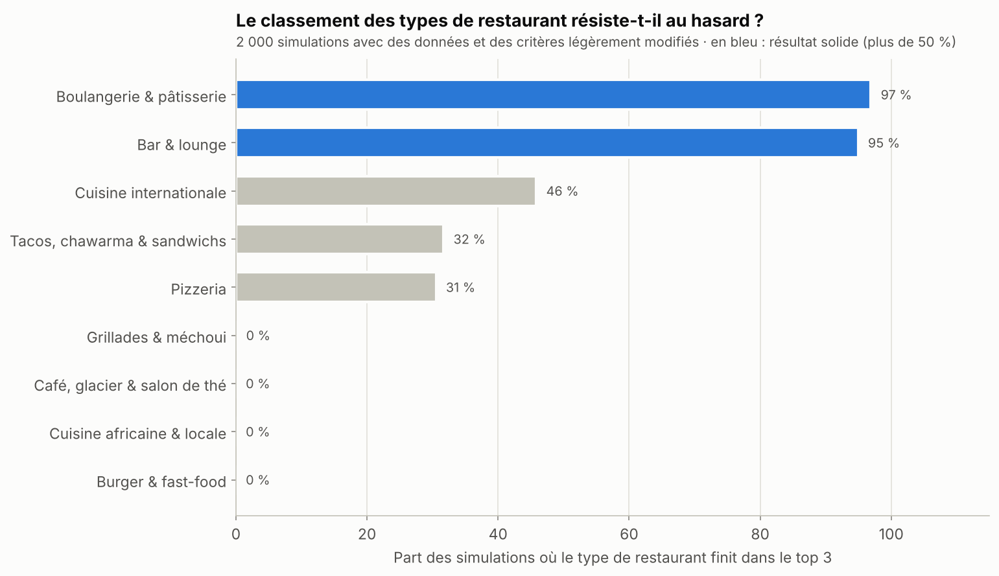
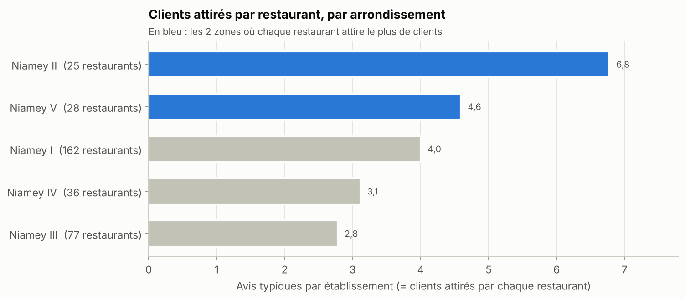
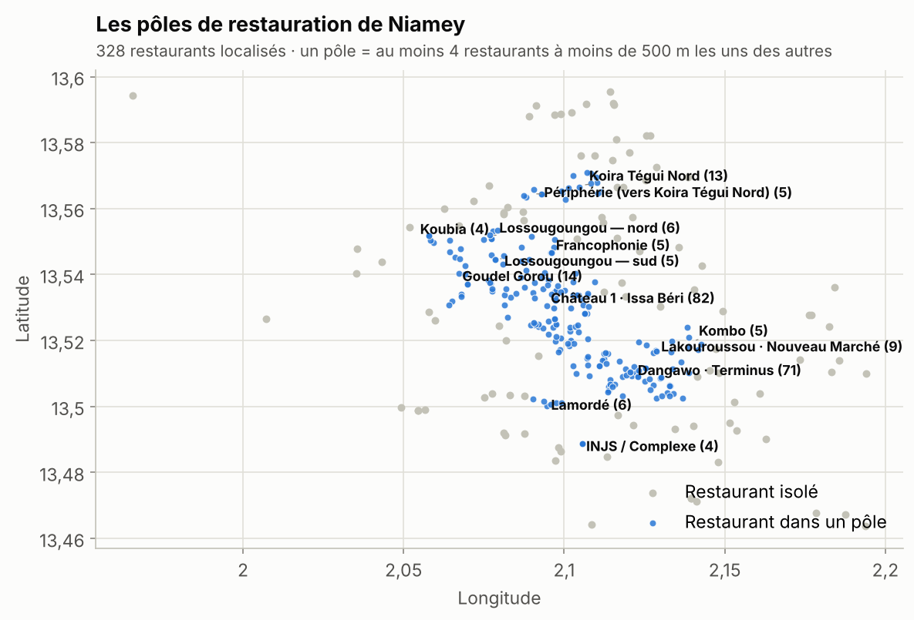

# Résultats détaillés

> Ce fichier est **généré automatiquement** par `python run_pipeline.py`
> (dernière exécution : 05/11/2026). Ne pas le modifier à la main.
> Pour l'explication de la démarche, voir le [README](README.md).

## En bref

1. **483 restaurants analysés** (sur 490 fiches Google Maps, après suppression des doublons et des commerces qui ne sont pas des restaurants).
2. **61 % des restaurants ont moins de 5 avis** : la réputation en ligne reste très peu développée à Niamey. Seuls 127 restaurants (26 %) ont une note vraiment solide (au moins 10 avis).
3. **85 des 86 restaurants notés 5★ ont 5 avis ou moins.** C'est pourquoi on utilise une *note corrigée*, qui ne se laisse pas impressionner par 1 ou 2 avis.
4. **Aucun type de cuisine n'est mieux noté qu'un autre** de façon fiable (p = 0,35). Ce qui distingue les concepts, c'est la **demande** (clients par établissement) et la **concurrence**.
5. **Concepts les plus prometteurs** : **Boulangerie & pâtisserie** (13 établissements, 17,8 avis typiques chacun, top 3 dans 97 % des simulations) ; **Bar & lounge** (12 établissements, 12,5 avis typiques chacun, top 3 dans 95 % des simulations). À comparer avec 3,7 avis pour un restaurant généraliste.
6. **Concepts saturés : Burger & fast-food** et **Cuisine africaine & locale** — 58 établissements, seulement 2,3 avis chacun ; 54 établissements, seulement 2,7 avis chacun.
7. **Où ?** 47 % des restaurants localisés sont concentrés dans 2 pôles. Dans le pôle **Château 1 · Issa Béri** (82 restaurants), chaque restaurant attire 6,7 avis typiques, contre 2,6 dans le pôle **Dangawo · Terminus** (71 restaurants), soit 2,5× moins de clients par restaurant dans ce dernier. Par arrondissement, **Niamey II** arrive en tête (n°1 dans 79 % des simulations).
8. **Un site web va de pair avec 8× plus d'avis** (médiane 15,5 contre 2,0, p < 0,001), **mais pas avec une meilleure note** (p = 0,11) : c'est un levier de visibilité, pas de qualité.

> ⚠️ Les données proviennent d'une extraction Google Maps centrée sur les restaurants : les boulangeries, bars ou cafés qui ne sont pas référencés comme restaurants y sont probablement sous-représentés, et leur concurrence réelle est donc sous-estimée. Avant d'investir, il faut **compter la concurrence réelle sur le terrain** — ces résultats indiquent des pistes, pas des certitudes.

## 1. Les données

| étape | nombre |
|---|---|
| Fiches dans l'export Google Maps | 490 |
| Lignes décalées réparées (URL dans la mauvaise colonne) | 1 |
| Doublons exacts supprimés (même lien Google Maps) | 0 |
| Doublons probables supprimés (même nom et même adresse) | 1 |
| Commerces hors restauration exclus (épicerie, parc, volailler...) | 6 |
| Restaurants retenus pour l'analyse | 483 |
| dont : avec une note Google | 367 |
| dont : localisés sur la carte (Plus Code) | 328 |
| dont : note solide (≥ 10 avis) | 127 |

- Source : export Google Maps (`data/raw/All_Niamey_Restaurants.csv`).
- 65 % des fiches sont simplement étiquetées « Restaurant » par Google. En lisant
  aussi le nom de l'établissement (« pizza », « grill », « maquis », « pâtisserie »…), on a pu
  préciser le type de 277 établissements ; 206 restent
  « Restaurant généraliste ».

## 2. Ce que disent les avis

| Constat | Chiffre |
|---|---|
| Note Google moyenne du marché | 4,10★ |
| Nombre d'avis médian par restaurant | 2 |
| Restaurants sans aucun avis | 116 |
| Restaurants avec moins de 5 avis | 61 % |
| Restaurants notés 5★ dont la note repose sur 5 avis ou moins | 85 sur 86 |
| Lien entre nombre d'avis et note (Spearman) | ρ = -0,30 (p < 0,001) : plus un restaurant a d'avis, plus sa note est « réaliste » |
| Les notes diffèrent-elles selon le type de cuisine ? (Kruskal-Wallis, 10 types) | Non : p = 0,35 |
| Avis (médiane) avec / sans site web | 15,5 / 2,0 (p < 0,001) |
| Note (médiane, ≥ 10 avis) avec / sans site web | 4,1 / 3,9 (p = 0,11) |

**Note corrigée** : on fait comme si chaque restaurant avait déjà reçu 10 avis « moyens »
(4,10★) avant ses vrais avis. Exemple : 5★ sur 1 avis devient
4,18★, alors que 4,9★ sur
443 avis reste à 4,88★.

## 3. Quel type de restaurant ouvrir ?

### Panorama

| Type de restaurant | Établissements | Part du marché | Avis au total | Avis typiques / établissement | Note corrigée moyenne |
|---|---|---|---|---|---|
| Restaurant généraliste | 206 | 42,7 % | 6 615 | 3,7 | 4,05 |
| Burger & fast-food | 58 | 12,0 % | 1 722 | 2,3 | 4,06 |
| Cuisine africaine & locale | 54 | 11,2 % | 538 | 2,7 | 4,02 |
| Café, glacier & salon de thé | 34 | 7,0 % | 273 | 3,6 | 4,12 |
| Grillades & méchoui | 28 | 5,8 % | 159 | 3,1 | 4,15 |
| Cuisine internationale | 28 | 5,8 % | 1 446 | 12,2 | 4,06 |
| Tacos, chawarma & sandwichs | 17 | 3,5 % | 488 | 6,9 | 4,14 |
| Boulangerie & pâtisserie | 13 | 2,7 % | 1 211 | 17,8 | 4,10 |
| Cantine & traiteur | 13 | 2,7 % | 328 | 3,1 | 4,17 |
| Bar & lounge | 12 | 2,5 % | 693 | 12,5 | 4,16 |
| Pizzeria | 10 | 2,1 % | 221 | 2,5 | 4,08 |
| Hôtel-restaurant | 10 | 2,1 % | 688 | 18,8 | 3,98 |

*Avis typiques / établissement* : nombre d'avis d'un établissement « ordinaire » du groupe
(moyenne géométrique, qui n'est pas faussée par une ou deux adresses très célèbres).

### Classement d'opportunité

Score = 45 % **demande** + 35 % **concurrence**
+ 20 % **marge de progression**. Seuls les types comptant au moins
5 établissements sont classés ; « Restaurant généraliste », « Hôtel-restaurant »
et « Cantine & traiteur » servent de référence.

| Rang | Groupe | Établissements | Avis typiques / établissement | Note corrigée moyenne | Demande (0-1) | Concurrence (0-1) | Marge (0-1) | **Score** | Top 3 (simulations) | Confiance |
|---|---|---|---|---|---|---|---|---|---|---|
| 1 | **Boulangerie & pâtisserie** | 13 | 17,8 | 4,10 | 1,00 | 0,85 | 0,40 | **0,83** | 97 % | Bonne |
| 2 | **Bar & lounge** | 12 | 12,5 | 4,16 | 0,81 | 0,90 | 0,34 | **0,75** | 95 % | Moyenne |
| 3 | **Cuisine internationale** | 28 | 12,2 | 4,06 | 0,80 | 0,41 | 0,44 | **0,59** | 46 % | Bonne |
| 4 | **Tacos, chawarma & sandwichs** | 17 | 6,9 | 4,14 | 0,51 | 0,70 | 0,36 | **0,54** | 32 % | Moyenne |
| 5 | **Pizzeria** | 10 | 2,5 | 4,08 | 0,04 | 1,00 | 0,42 | **0,45** | 31 % | Faible |
| 6 | **Grillades & méchoui** | 28 | 3,1 | 4,15 | 0,13 | 0,41 | 0,35 | **0,27** | 0 % | Moyenne |
| 7 | **Café, glacier & salon de thé** | 34 | 3,6 | 4,12 | 0,19 | 0,30 | 0,38 | **0,27** | 0 % | Bonne |
| 8 | **Cuisine africaine & locale** | 54 | 2,7 | 4,02 | 0,07 | 0,04 | 0,48 | **0,14** | 0 % | Bonne |
| 9 | **Burger & fast-food** | 58 | 2,3 | 4,06 | 0,00 | 0,00 | 0,44 | **0,09** | 0 % | Bonne |

*Top 3 (simulations)* : part des 2 000 simulations (échantillon de restaurants et poids des
critères tirés au hasard) où le type finit dans les 3 premiers. **Au-dessus de 50 %, le résultat est robuste.**
*Confiance* : Bonne = au moins 8 établissements avec une note solide, Moyenne = 4 à 7, Faible = moins de 4.

## 4. Où ?

328 restaurants (68 %) ont une position exploitable (Plus Code Google).
L'arrondissement et le quartier sont estimés en rattachant chaque restaurant au centre de quartier le plus
proche (référentiel approximatif : `data/raw/niamey_quartiers_reference.csv`).

### Par arrondissement

| Rang | Groupe | Établissements | Avis typiques / établissement | Note corrigée moyenne | Demande (0-1) | Concurrence (0-1) | Marge (0-1) | **Score** | N°1 (simulations) | Confiance |
|---|---|---|---|---|---|---|---|---|---|---|
| 1 | **Niamey II** | 25 | 6,8 | 4,01 | 1,00 | 1,00 | 0,49 | **0,90** | 79 % | Bonne |
| 2 | **Niamey V** | 28 | 4,6 | 4,06 | 0,54 | 0,94 | 0,44 | **0,66** | 20 % | Bonne |
| 3 | **Niamey IV** | 36 | 3,1 | 4,05 | 0,12 | 0,80 | 0,45 | **0,43** | 1 % | Moyenne |
| 4 | **Niamey I** | 162 | 4,0 | 4,05 | 0,39 | 0,00 | 0,45 | **0,26** | 0 % | Bonne |
| 5 | **Niamey III** | 77 | 2,8 | 4,08 | 0,00 | 0,40 | 0,42 | **0,22** | 0 % | Bonne |

### Par pôle de restauration

Un **pôle** est un groupe d'au moins 4 restaurants situés à moins de
500 m les uns des autres (algorithme DBSCAN). On en trouve 13, qui regroupent
229 restaurants ; les 11 pôles d'au moins 5 restaurants sont classés
ci-dessous. Attention : la plupart sont petits (confiance *faible*), seul le contraste entre les deux grands
pôles est vraiment solide.

| Rang | Groupe | Établissements | Avis typiques / établissement | Note corrigée moyenne | Demande (0-1) | Concurrence (0-1) | Marge (0-1) | **Score** | Top 3 (simulations) | Confiance |
|---|---|---|---|---|---|---|---|---|---|---|
| 1 | **Périphérie (vers Koira Tégui Nord)** | 5 | 3,8 | 4,12 | 0,62 | 1,00 | 0,38 | **0,70** | 59 % | Faible |
| 2 | **Kombo** | 5 | 3,5 | 4,05 | 0,56 | 1,00 | 0,45 | **0,69** | 57 % | Faible |
| 3 | **Lamordé** | 6 | 3,1 | 4,03 | 0,48 | 0,93 | 0,47 | **0,64** | 44 % | Faible |
| 4 | **Lossougoungou — nord** | 6 | 2,6 | 4,00 | 0,39 | 0,93 | 0,50 | **0,60** | 33 % | Faible |
| 5 | **Francophonie** | 5 | 2,0 | 3,77 | 0,22 | 1,00 | 0,73 | **0,60** | 43 % | Faible |
| 6 | **Koira Tégui Nord** | 13 | 3,6 | 4,14 | 0,58 | 0,66 | 0,36 | **0,57** | 11 % | Faible |
| 7 | **Lossougoungou — sud** | 5 | 2,0 | 4,04 | 0,23 | 1,00 | 0,46 | **0,55** | 28 % | Faible |
| 8 | **Château 1 · Issa Béri** | 82 | 6,7 | 4,03 | 1,00 | 0,00 | 0,47 | **0,54** | 14 % | Bonne |
| 9 | **Goudel Gorou** | 14 | 3,0 | 4,08 | 0,47 | 0,63 | 0,42 | **0,52** | 11 % | Faible |
| 10 | **Lakouroussou · Nouveau Marché** | 9 | 1,3 | 4,06 | 0,00 | 0,79 | 0,44 | **0,36** | 0 % | Faible |
| 11 | **Dangawo · Terminus** | 71 | 2,6 | 4,10 | 0,39 | 0,05 | 0,40 | **0,27** | 0 % | Bonne |

## 5. Pistes concrètes : quel type, à quel endroit ?

Pour les types les plus prometteurs, les pôles où ils sont absents (ou presque) :

| Type | Pôle | Concurrents du même type dans le pôle | Restaurants dans le pôle | Avis dans le pôle | Score de la piste |
|---|---|---|---|---|---|
| Boulangerie & pâtisserie | Château 1 · Issa Béri | 0 | 82 | 4 460 | 0,80 |
| Bar & lounge | Château 1 · Issa Béri | 1 | 82 | 4 460 | 0,76 |
| Bar & lounge | Dangawo · Terminus | 0 | 71 | 2 244 | 0,64 |
| Boulangerie & pâtisserie | Francophonie | 0 | 5 | 114 | 0,61 |
| Boulangerie & pâtisserie | Kombo | 0 | 5 | 65 | 0,61 |
| Boulangerie & pâtisserie | Koira Tégui Nord | 0 | 13 | 112 | 0,60 |
| Boulangerie & pâtisserie | Goudel Gorou | 0 | 14 | 150 | 0,60 |
| Boulangerie & pâtisserie | Périphérie (vers Koira Tégui Nord) | 0 | 5 | 36 | 0,58 |
| Bar & lounge | Francophonie | 0 | 5 | 114 | 0,58 |
| Bar & lounge | Kombo | 0 | 5 | 65 | 0,58 |

## 6. Limites à garder en tête

- **Avis ≠ ventes.** Le nombre d'avis Google sert d'indicateur de fréquentation, mais beaucoup de clients
  ne laissent jamais d'avis, surtout dans les établissements populaires et informels.
- **Données incomplètes.** Extraction centrée sur les restaurants ; 32 % des
  établissements n'ont pas de position exploitable ; une partie des restaurants de Niamey n'est pas sur
  Google Maps.
- **Petits groupes.** Plusieurs types et pôles comptent moins de 15 établissements : la colonne
  *Confiance* et les simulations indiquent jusqu'où on peut s'y fier.
- **Quartiers approximatifs.** Les centres de quartiers sont des repères approximatifs, pas des limites officielles.
- **Photo à un instant donné.** Pas d'historique : impossible de voir les ouvertures/fermetures ni les tendances.
